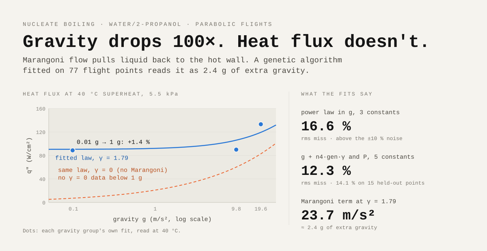

# Microgravity Boiling — Genetic-Algorithm Models


Course project, UC Berkeley **ME249** (Fall 2026, Prof. V. P. Carey), done alone, including the two
extra tasks meant for teams of three. A genetic algorithm fits nucleate-boiling data of a
water/2-propanol mixture measured on NASA parabolic flights from 0.01 g to 2 g, then calibrates a
heat-pipe exchanger that cools an electronics cabinet.
The interesting result is less the best fit than what the fit can and cannot pin down.



**Report:** [`report/Project 2 AHALI ADNAN ME249.pdf`](report/Project%202%20AHALI%20ADNAN%20ME249.pdf)
(24 pages + code appendix). **Poster:** [adnandbss.github.io/projects/microgravity-boiling](https://adnandbss.github.io/projects/microgravity-boiling/).

## Results

| Task | Best fit found by the genetic algorithm | Error (target) |
| --- | --- | --- |
| 2.2 | q″ = 1.72·10⁻³ (Tw−Tsat)^2.975 g^0.0438 | 0.02870 (< 0.035) |
| 2.3 | q″ = 1.20·10⁻⁴ (Tw−Tsat)^3.022 (g + 1.349 g_en γ)^0.462 P^0.544 | 0.02097 (< 0.03), 0.0257 on 15 held-out points |
| ET2 | (Tw−Tsat) = 20.27 q″^0.3074 (g + 1.308 g_en γ)^−0.1455 P^−0.1485 | 0.00843 |
| 2.5 | (UA)e = 5.71 W/°C, (UA)c = 5.43 W/°C, α = 1.13 | MAE 0.0166 training, 0.0208 validation (< 0.045) |

Every best fit was checked against a deterministic minimum of the same error function (SciPy
Nelder–Mead, used only as a check): the GA is within 0.03 % (2.2), 0.6 % (2.3) and 0.01 % (2.5) of it.

- **The power law in g misses by 16.6 % rms**, above the ±10 % noise of the data, and not at random:
  19 % high at 1 g, 16 % low at 2 g. A power law in g cannot hold the Marangoni effect.
- **The five-constant law brings the miss to 12.3 %** (14.1 % on held-out points). Surface tension
  enters as an extra gravity, g + n4·g_en·γ: for γ = 1.79 the Marangoni flow is worth 23.7 m/s²,
  about 2.4 g, which is why 0.01 g barely changes the heat flux. Two groups are still biased
  (1 g: −16 %, 2 g at 5.5 kPa: +11 %), so part of the gravity effect is still missing.
- **Superheat dominates (ET1).** A 1 % error on it moves the heat flux by 3 %; a 15 % budget needs the
  superheat within about ±1.9 °C at 40 °C.
- **The inverse fit differs by 5–10 % (ET2)**, and synthetic data show why: scatter alone shifts the
  superheat exponent by −7 ± 2 % (regression dilution). Without noise the two fits agree to 0.03 %.
- **The heat-pipe data fix only the series conductance**, 2.907 W/°C. An evaporator conductance anywhere
  from 5 to 11 W/°C fits equally well; separating evaporator from condenser needs a wall temperature.

## What 300 runs say about the algorithm

- **A low error is not proof of the right constants.** The error surface is a long valley
  (ln n1 + 3.7 n2 ≈ const): every n2 from 2.2 to 3.6 meets the 0.035 target.
- **Far from the solution, ±8.5 % mutations stall**, and 20,000 generations do not help. ±40 % mutations
  reach the valley; a second stage with ±3 % mutations refines the result.
- **The skeleton selection can freeze.** Started at (1, 1, 1), every organism has nearly the same error,
  none beats 0.5 × median, `nkeep = 0` at every generation, and all offspring descend from a frozen
  `n[0]`. Keeping the better half (`MFRAC = 1`) fixes it.
- **Multiplicative mutations cannot move a constant guessed near zero**: ±9 % of 0.01 is ±0.0009.

## Fixes to the skeleton code

- `import random` in `CodeP2.2F26` rebinds `random` to the module, so `random()` raises
  `TypeError: 'module' object is not callable` and the combined program never runs.
  Replaced by `from random import random, seed`.
- Two data values disagreed with the appendix of the statement (44.2 → 44.1 W/cm², 37.8 → 37.5 °C).
- `numpy.random` was never seeded; every run is now reproducible from its seed.

All changes are listed in Section 5 of the report and marked by comments in the code.

## Layout

```
code/                     Jupyter notebooks, executed with their outputs
  P2_Task2.1.ipynb        data check against the appendix, log-log plot
  P2_Task2.2.ipynb        three-constant model, initial-guess study, error landscape
  P2_Task2.3.ipynb        five-constant model, validation, surface plot, identifiability
  P2_ET1.ipynb            fractional sensitivity of q″ to each input
  P2_ET2.ipynb            inverse relation for the superheat, synthetic-noise test
  P2_Task2.4-2.5.ipynb    heat-pipe model, train/validation split, NGEN and MFRAC study
  results/*.json          numbers used by the report tables
report/                   LaTeX sources, figures, generated tables, the PDF
tools/                    make_tables.py (results → LaTeX tables), export_code.py (notebooks → listings)
```

## Reproduce

```bash
python3 -m venv .venv && source .venv/bin/activate
pip install -r requirements.txt
cd code
for nb in P2_Task2.1 P2_Task2.2 P2_Task2.3 P2_ET1 P2_ET2 P2_Task2.4-2.5; do
  jupyter nbconvert --to notebook --execute --inplace --ExecutePreprocessor.timeout=3600 "$nb.ipynb"
done
cd ..
python3 tools/make_tables.py && python3 tools/export_code.py
cd report && tectonic report.tex
```

Run the notebooks in this order: ET1 and ET2 read the Task 2.3 constants from `code/results/task23.json`.
Each genetic-algorithm notebook takes about 5–8 minutes. All runs are seeded, so the numbers come out
identical. Cell 3 of `P2_Task2.1` compares the data with the original skeleton file
`CodeP2.1F26.ipynb`, expected at the repository root (course material, not included).

## Course material

The assignment statement and the original skeleton notebooks belong to the course and are not
redistributed here. The notebooks contain the skeleton genetic algorithm (headers marked
*V.P. Carey, ME249*), modified as documented, because the report must include each program.

## Licence

MIT for my own code, figures and text. The skeleton code portions and the experimental data come from
the ME249 course.
